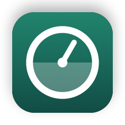
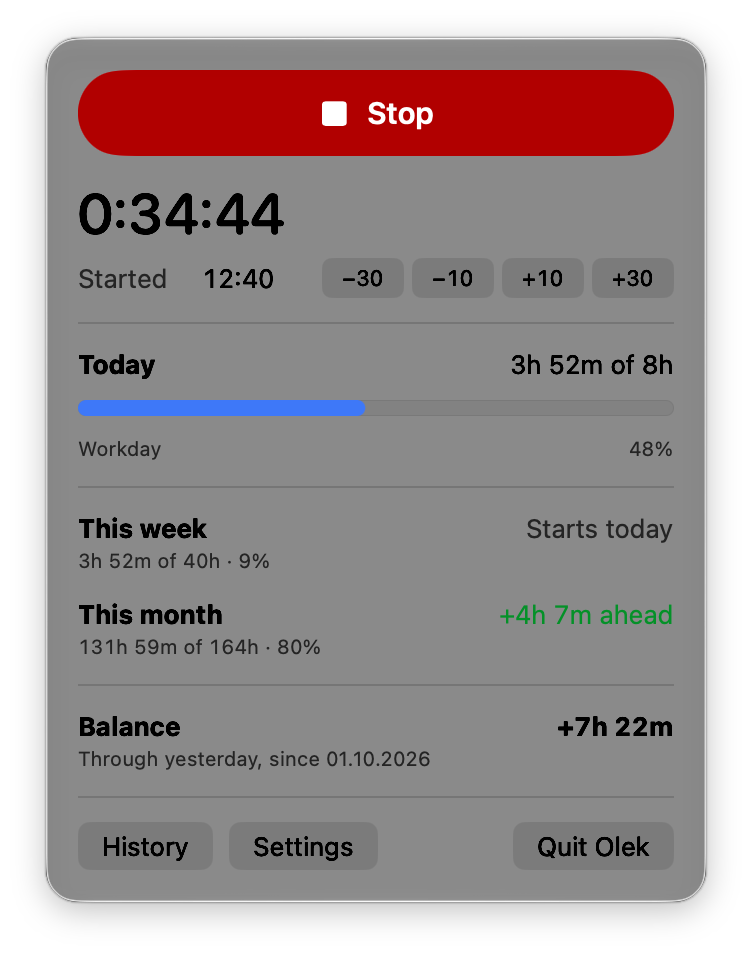
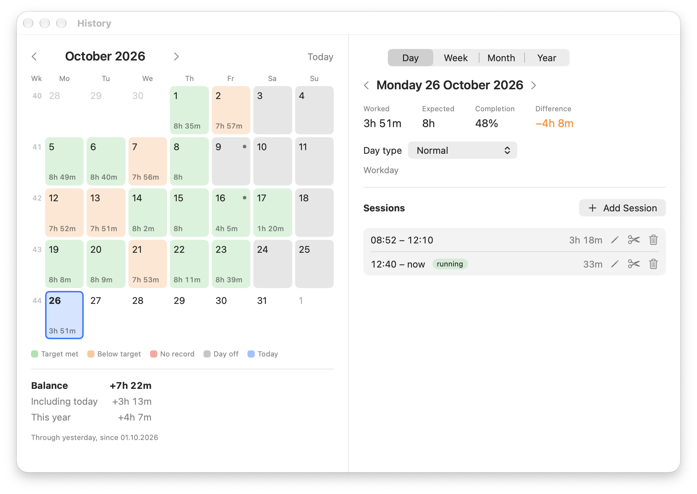
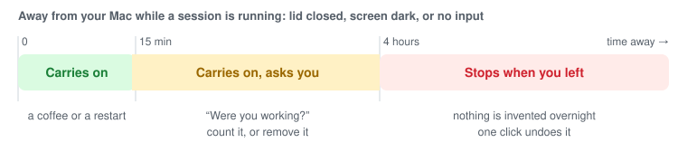

<p align="center">
  
</p>

<h1 align="center">Olek</h1>

<p align="center"><em>Your time. Your balance.</em></p>

*Olek* is Estonian for *state*, and this app has exactly two: working and not working. It sits in the Mac menu bar, records your working time with a single toggle, compares it with the hours you are expected to work, and keeps a running balance of overtime and undertime across weeks and months.

It knows Estonian public holidays and the shortened days before them. It nudges you when you forget to start or stop, and it never makes up time it did not see. Everything stays on your Mac.

<p align="center">
  
  
</p>

## Getting it

**Download.** Take the latest `Olek-x.y.z.zip` from [Releases](../../releases), unzip it, and drag Olek into Applications. Olek is not notarized by Apple, so the first launch of each version is blocked. Open System Settings, go to Privacy & Security, and click **Open Anyway**. It runs on Apple Silicon Macs with macOS 14 or later.

**Build it.** With Xcode Command Line Tools installed:

```sh
git clone git@github.com:tammets/olek.git && cd olek
scripts/install.sh
```

That builds Olek, puts it in Applications, and opens it. Run it again after pulling changes to update. Your data lives outside the app, so updates never touch it.

**First steps.** Open Settings from the popover. Check your weekly hours, set when the accounting starts, and add an opening balance if you are bringing hours over from somewhere else. Then turn on *Open Olek at login*.

## How it counts

**Expected hours** come from your weekly schedule, by default eight hours Monday to Friday. Estonian public holidays count as zero, Easter-based ones included. Under Employment Contracts Act § 53, the working day right before New Year's Day, Independence Day, Victory Day, and Christmas Eve is three hours shorter. That applies only when that calendar day is a working day for you, so a Monday holiday does not shorten the Friday. Vacation, sick leave, a day off, or a half day can be set for any date and win over everything else.

**The balance** adds up worked minus expected for every day from the accounting start through yesterday. Today is still in progress, so it gets its own progress bar instead of greeting you with −8h every morning. The week and the month each show two numbers: how far ahead or behind you are through yesterday, and how much of the whole period is done.

**Sleep, restarts, and crashes** never create hours out of nothing. While you track, Olek notes every minute that it is alive, and it decides by how long it was away:

<p align="center">
  
</p>

**Reminders** go by one number: how long ago the keyboard, mouse, or trackpad was last used. Olek never sees what you type or which apps you use.

- Tracking, but nobody has touched the Mac for 15 minutes: *Still working?* Keep going, stop now, stop when you went idle, or be asked later. Being idle never stops tracking on its own, since meetings and reading are work too.
- Using the Mac for 10 minutes without tracking: *Start tracking?*, from when the activity began or a time you pick. This only happens on workdays that have not reached their hours yet, and after you stop, Olek waits until you have been away before it asks again.

All thresholds can be changed in Settings.

## Fixing the record

The popover has −30, −10, +10, and +30 next to the start and stop times. Each button moves only the time next to it, so "−10 next to Started" can only mean you started ten minutes earlier.

**History** (Cmd-Y) shows a month calendar coloured by whether each day met its target, and day, week, month, and year views. From there you can add a forgotten session, edit or delete one, cut a lunch break out of a long one, and mark days as vacation or sick leave. Edits that would overlap another session or reach into the future are refused with a reason.

## Your data

Everything is in one SQLite file in `~/Library/Application Support/Olek`. Nothing is sent anywhere, and there is no account.

The Data tab in Settings exports sessions or a daily summary with the running balance as CSV, and makes single-file backups. A restore checks the file first, shows what is in it, and copies your current data to a `Backups` folder before replacing anything, so it can always be undone.

## Development

Swift 6, SwiftUI, and the system SQLite library, with no third-party dependencies. It builds with Xcode Command Line Tools alone; the full Xcode app is not needed.

| Command | Does |
|---|---|
| `scripts/run.sh` | Build and launch **Olek Dev**, a separate copy with its own data |
| `scripts/test.sh` | Run the tests |
| `scripts/install.sh` | Build a release and install it in Applications |
| `scripts/package.sh` | Build a release zip in `dist/` |

`Sources/OlekCore` holds all the rules (calendar, holidays, balance, reminders, storage) and has no UI, which keeps it fully testable. `Sources/Olek` is the menu bar app. The icon is drawn in code by `scripts/make-icon.swift`.

**Releasing.** Bump `VERSION`, commit, and push an annotated tag whose message is the release notes in Markdown:

```sh
git tag -a v1.1.0 --cleanup=verbatim -F notes.txt
git push origin v1.1.0
```

GitHub Actions then tests, builds, and publishes the release with the zip and its checksum.

## Limits, for now

- Times use a 24-hour clock and dates are written day first.
- The interface is in English. It is ready for translation, and Estonian is next.
- Builds are not notarized, so each new download needs *Open Anyway* once.

---

<p align="center"><sub>Built with <a href="https://claude.com/claude-code">Claude Code</a>. No Xcode project was opened, harmed, or created in the making of this app.</sub></p>
